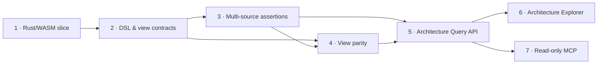

# Kontur roadmap — Architecture as Context

> **Vision:** Architecture that knows when reality changes. Model · Discover · Reconcile.
> **Direction:** Architecture as Context — architecture facts usable by developers, reviewers, coding agents and tools, not only diagrams.

This is the **strategic roadmap**, not an independent status tracker. [GitHub issues](https://github.com/kodemaniak/kontur/issues) and PRs are authoritative for progress; [OpenSpec](../openspec/specs) specifies technical behavior. Update this document when milestones, dependencies or architectural decisions change, rather than mirroring individual task checkboxes.

## Current starting point (19 November 2026)

- [PR #20](https://github.com/kodemaniak/kontur/pull/20) (open draft) provides the **first** shared Rust-to-WASM Playground vertical slice, native/WASM compile-result parity and a browser Mermaid presenter. **Not yet complete or merged.**
- [PR #21](https://github.com/kodemaniak/kontur/pull/21) (open) updates the website pitch with Architecture as Context. It does not implement MCP or agent integrations.
- The existing Rust CLI/VS Code preview supports only a documented DSL/view subset. The browser Playground has richer experimental behavior that should be migrated **incrementally, not rewritten**. [Core contracts](core-api.md) and [current DSL subset](dsl-subset.md) describe the base.
- Existing OpenSpec capabilities include parsing, model, validation, resolution, view projection, diagnostics and preview. Those specifications are design/test contracts, **not evidence of complete Playground parity**.

## Milestones and dependencies

| # | Milestone | Outcome / acceptance signal | Tracking |
| --- | --- | --- | --- |
| **1** | Shared Rust/WASM vertical slice | Same editable representative DSL compiled by native Rust and browser/WASM into compatible JSON and Mermaid preview; landing page preserved | [PR #20](https://github.com/kodemaniak/kontur/pull/20) — open draft |
| **2** | DSL and view-selection parity | Common DSL/view-selection contract, stable IDs and diagnostics, fixtures executable in both hosts | [#22](https://github.com/kodemaniak/kontur/issues/22) |
| **3** | Multi-source assertions and reconciliation | Source-aware assertions, explicit identity matching, provenance, honest ambiguity/conflict states; synthetic multi-repo example | [#23](https://github.com/kodemaniak/kontur/issues/23) |
| **4** | Full Playground view parity | Port the **eight existing Playground views** to Rust projections; fix component scoping; remove duplicate JS parsing/merge/semantics only when parity is proven | [#24](https://github.com/kodemaniak/kontur/issues/24) |
| **5** | Architecture Query API | Renderer-independent, source-aware structured queries for systems, APIs, responsibilities, platforms and dependencies | [#25](https://github.com/kodemaniak/kontur/issues/25) |
| **6** | Architecture Explorer | Click/tap element details, compact graph views, searchable API catalog and linked OpenAPI/AsyncAPI reference UI | [#26](https://github.com/kodemaniak/kontur/issues/26) |
| **7** | Read-only MCP / Agent Context | The **same** query semantics exposed locally through MCP to coding agents, with source and uncertainty information | [#27](https://github.com/kodemaniak/kontur/issues/27) |

The numbers describe a **logical dependency order**, not time commitments. Milestone 1 precedes 2. Multi-source semantics (3) and full view parity (4) make the query contract (5) complete; initial query design can begin before all views are ported. **Explorer (6) and MCP (7) can proceed in parallel once a sufficient query contract exists.** Do not make MCP depend on the web UI.

### Dependency sketch

## Architectural guardrails

1. **One semantic core.** Parsing, identity, reference resolution, validation, reconciliation and typed view/query projections belong in Rust. Native service/CLI, browser/WASM, VS Code and MCP share the model and semantics. Source locations and stable IDs survive every projection.
2. **Architecture as facts, not pictures.** A view is a typed projection. Mermaid is a replaceable graph renderer; catalog, detail, responsibility and reconciliation views need not be graphs. The core must not depend on Mermaid, browser frameworks or MCP transport.
3. **Git-versioned sources remain authoritative.** Kontur DSL and linked, versioned OpenAPI/AsyncAPI contracts provide the documented architecture. Discovered and measured evidence can add assertions; neither they nor a central index silently rewrite the DSL. AI changes remain Git-reviewed edits.
4. **Multiple truths remain visible.** Keep each source's assertions and provenance. Distinguish confirmation, complement, ambiguity and actual contradiction. Missing data is not negation; two people with the same responsibility role are not a conflict by default.
5. **Explicit architecture semantics.** APIs are first-class contracts, including async APIs with multiple topics; personal and team responsibilities are separate, multivalued typed relations. Platforms are products with capabilities and environments. An API `usesCapability` independently of a service's business `publishes`, `subscribes`, `provides` or `consumes` relationships. Distinguish application stages from platform environments; do not infer mappings from names.
6. **Reuse renderers.** Keep Mermaid as the initial graph presenter; evaluate existing OpenAPI and AsyncAPI rendering components before custom documentation UI. No second browser-side source-of-truth model implementation.
7. **Local-first and incremental.** A functioning VS Code preview and the landing page must keep working. Synthetic fixtures belong in the public repository; real customer/project models do not. Resist new plugin engines, hosted registries and policy frameworks until requirements justify them.

## Product experience, built on the query API

- **Graph views:** Focus on topology, deployment and dependencies. Show role assignments, metadata, source assertions and conflicts in click/tap details instead of multiplying nodes.
- **Catalog views:** Search APIs, systems and platform capabilities; filters operate on the shared semantic model.
- **Contract details:** Link to versioned OpenAPI/AsyncAPI specs and display them with established renderers.
- **Agent context:** Expose source-aware answers to questions such as “What does this service provide, consume, depend on, and who is responsible?” via the same core queries over read-only MCP.
- **Projections, not guesses:** Expose explicit claims separately from inferred technical impact and from unverified observations.

## Tracking and delivery workflow

- A **milestone issue** owns acceptance criteria, dependency links, and further scoped implementation issues/PRs. Do not duplicate all implementation tasks here.
- Before a substantive implementation change, add/update a relevant [OpenSpec capability](../openspec/specs) with contract, error cases, source provenance and tests. Link the change from its issue/PR.
- Work in short, testable PRs. Follow the repository's red/green/refactor guidance in [AGENTS.md](../AGENTS.md). Prefer a vertical slice across parser/model/projection/presenter over speculative generic infrastructure.
- A milestone is **complete only when its acceptance criteria are validated and code is merged**; an open PR or prototype is not a finished milestone.
- Keep implementation status and decisions on issues/PRs; amend this document when a milestone's scope or ordering materially changes.

## Scope boundaries / later work

A generic policy engine, RDF-style assertion reification, full Kubernetes/IaC discovery, a central multi-tenant aggregation service, write-capable MCP and workflow automation are **not** prerequisites to the seven milestones. Future policy rules may constrain relationship cardinality, but the base model allows multiple named owners per role. Later evidence/discovery and federated search build on — rather than replace — the same assertion and query foundations.

## Related work and specifications

- [Initial Rust/WASM integration: PR #20](https://github.com/kodemaniak/kontur/pull/20)
- [Architecture as Context landing-page pitch: PR #21](https://github.com/kodemaniak/kontur/pull/21)
- [Architecture-model, validation, parsing and projection specs](../openspec/specs)
- [Core API and host/service contract](core-api.md)
- [Currently supported DSL subset](dsl-subset.md)
