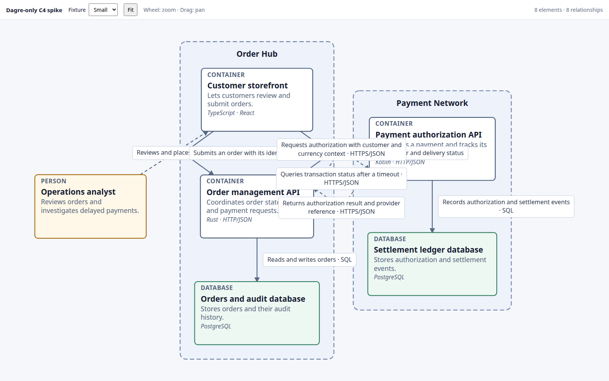

# Dagre-only spike

Standalone graph layout using `@dagrejs/dagre` directly, with browser-native SVG rendering of the shared small and large fixtures. Dagre owns node placement and the routes it produces. Its compound graph does not return routes for every cross-cluster edge in these fixtures; those edges use visibly dashed fallback paths so no relationships disappear.

From `spikes/visualization/`:

```sh
npm run dev:dagre-only
npm run test:dagre-only
```

This is a renderer comparison, not an adoption decision. System boxes are drawn around Dagre's compound-node children; fallback edges are diagnostic, not a general route policy. Edge-label collision avoidance is not implemented, and the large fixture is very tall at fit-to-view.


