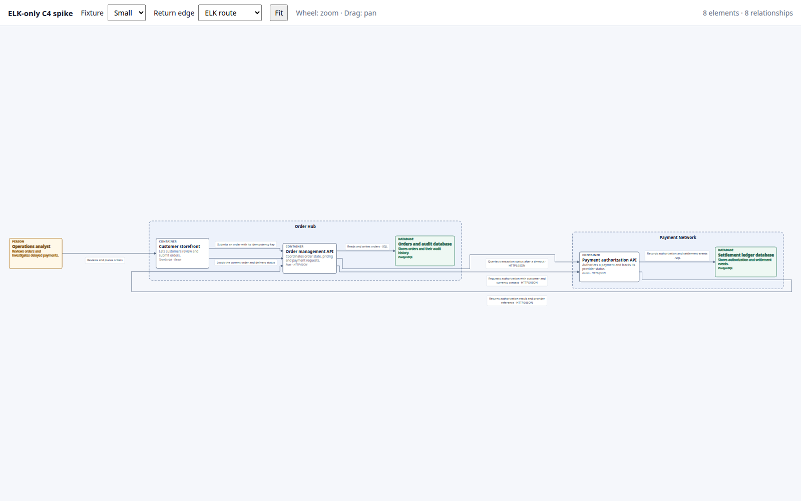

# ELK.js-only spike

Standalone comparison using ELK.js for layout/routing and browser-native SVG/DOM for rendering. The app does not import React, React Flow, or Sprotty. It reuses the same small and large fixtures.

From `spikes/visualization/`:

```sh
npm run dev:elk-only
npm run test:elk-only
```

The renderer translates ELK's hierarchical node and edge coordinates into one SVG coordinate space, draws ELK's orthogonal route sections and edge-label boxes, and implements only viewport pan/zoom. It contains no custom layout or route generation.

## Current evidence

The headless browser check passes for both fixtures: all elements, relationships and labels render; child boxes remain within their systems; route endpoints meet their source and target boxes; wheel zoom changes the view. Results and screenshots are in `../results/elk-only-comparison.json` and `../results/elk-only-*.png`.

The full-fit view is very wide and the 101-element graph is too small to read without zooming. This is an initial renderer spike, not an adoption decision or a complete accessibility/interaction evaluation.

The reverse inter-system relationship from Payment Authorization API to Order Management API is a feedback edge against the left-to-right layered flow. ELK routes it around the system groups to avoid crossing their contents, which is correct but visually circuitous. Built-in routing/side hints did not improve it without destabilizing the system ordering.

The small-fixture **Return edge** selector compares that ELK route with one manual override. The override derives its endpoints from ELK's node bounds, then routes outside the Payment Network's left edge and below both system groups before entering Order Management API from below. Only the bendpoints and label position for `r-payment-order-result` are replaced; all node placement and other edges remain ELK-owned. This is a spike-specific renderer override, not DSL support or a general route policy.


