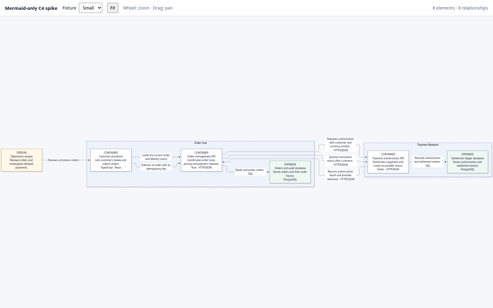

# Mermaid.js-only spike

Standalone Mermaid flowchart rendering of the shared small and large C4 fixtures. Mermaid owns the diagram layout and relationship routing; the viewer only adds fixture selection and SVG viewBox pan/zoom.

From `spikes/visualization/`:

```sh
npm run dev:mermaid-only
npm run test:mermaid-only
```

This is a renderer comparison, not a DSL export format or an adoption decision. Mermaid's subgraph and edge layout can differ from ELK and is not expected to preserve ELK's placement or route geometry.

The headless browser check verifies element, relationship and label counts on both fixtures and exercises fit, zoom and drag-pan. Screenshots and comparison data are saved under `../results/`.

The large fixture fits as an extremely wide overview, so labels are difficult to read without zooming. Mermaid's native output is useful for a quick diagram but does not offer the same relationship routing control as the ELK renderer.


