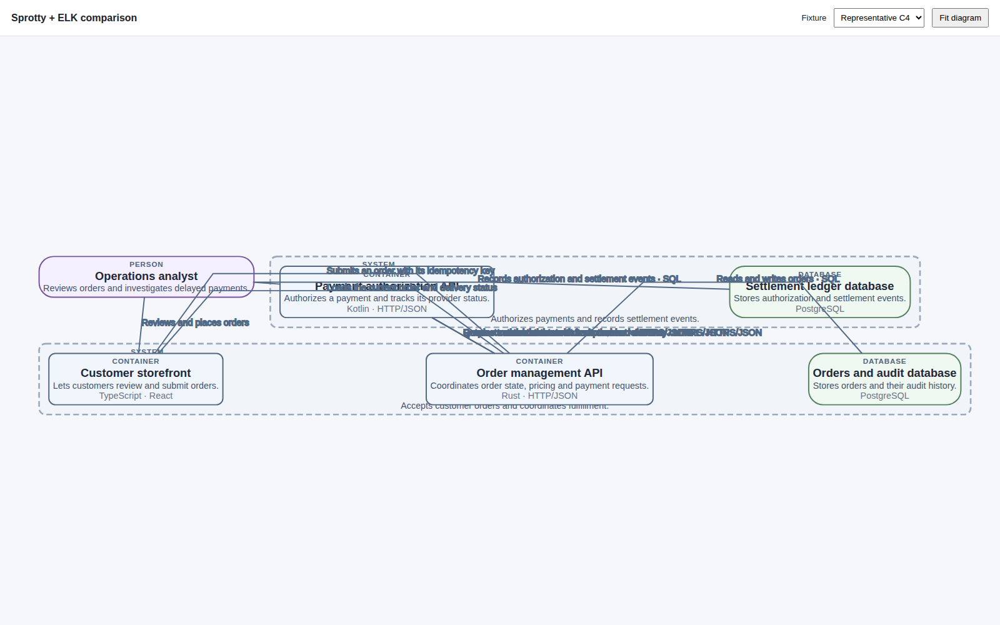

# Sprotty + ELK

Start from `spikes/visualization/` with `npm run dev:sprotty`; open `http://127.0.0.1:5174`. Run `npm run test:sprotty` for the Chromium check of both shared fixtures.

The browser check found all nested elements contained and routes attached, with wheel zoom working. Label collisions remain (5/8 small and 43/105 large), and the large fit view is too small to read. This read-only viewer is an isolated comparison, not part of the VS Code package.

