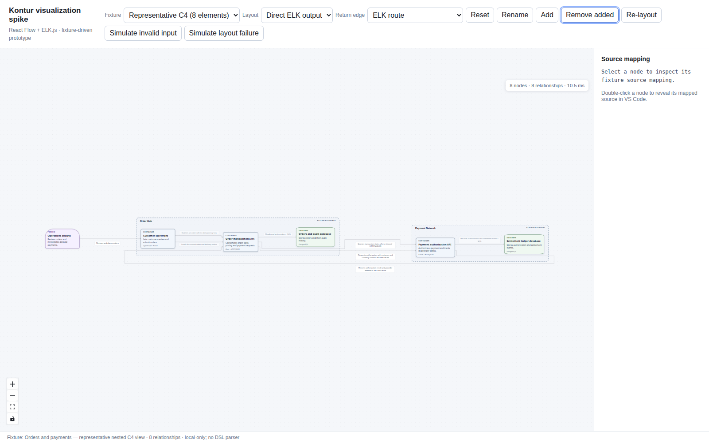

# React Flow + ELK

Start from `spikes/visualization/` with `npm run dev`; open `http://127.0.0.1:5173`. `npm run test:browser` exercises the production viewer in Chromium; `npm run verify` covers typecheck, unit tests and extension build.

The shared small/large fixtures render with interactive pan/zoom, source mapping, update controls, and a last-valid preview after simulated invalid input/layout failure. The direct-ELK geometry check reports contained children and attached routes for both fixtures (`node scripts/check-elk-geometry.mjs` after `npm run build`). The large fit view remains too small for detail, and this fixed-fixture spike does not test DSL parsing, LSP behavior, or accessibility beyond targeted keyboard checks.

